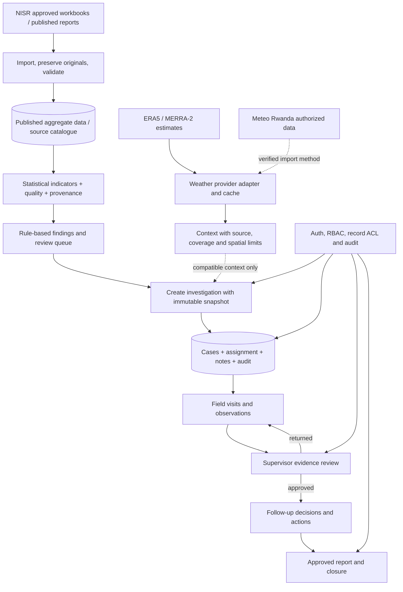
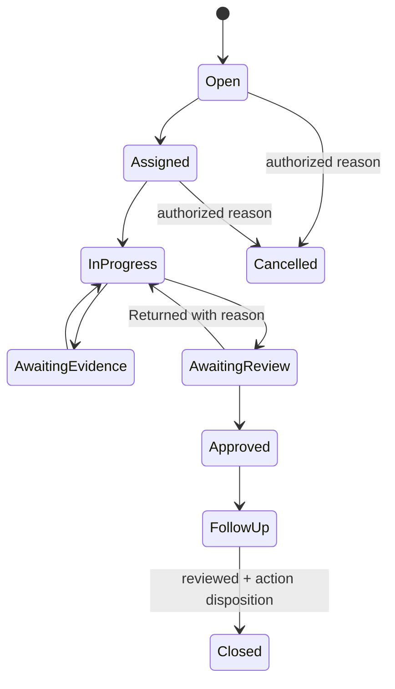

# Architecture and proposed service contracts

## Runtime architecture
- Frontend: existing React/TanStack routes, `FieldDashboard`, existing `WeatherContext`, existing query hooks, new focused subcomponents.
- API: authenticated server functions (TanStack Start) or backend routes, chosen after auditing local vs Supabase runtime. Never put D1 direct access or secrets in browser.
- Storage: existing D1 `local_records` or carefully reconciled typed tables; secure object storage for attachments if/when authorized. Use the existing source import pipeline, do not duplicate 55k observations into a separate ad-hoc dashboard table.
- Telemetry: events for data fetch failures, stale source, invalid comparison, case lifecycle, authorization denials and export approvals. Scrub PII.

## Proposed authenticated endpoints / function contracts (not yet implemented)
`getFieldOverview({district?, crop?, season?, year?}) -> {totals:{...}, signals:[...], assignments:[...], actions:[...], coverage:{...}, asOf, complete}`
`listFindings({filters, cursor, pageSize}) -> {items, nextCursor, total, sourceCoverage}`
`createCaseFromFinding({findingId, expectedVersion, question, assigneeId?, dueDate?, idempotencyKey}) -> {caseId, sourceSnapshotHash}`
`listCases({filter, cursor}) -> {items,nextCursor,total}`
`addCaseObservation({caseId, payload, expectedVersion}) -> {observationId, auditId}`
`scheduleFieldVisit({caseId, location, scheduledFor, checklist, assignees}) -> {visitId}`
`submitForReview({caseId, version}) -> {reviewId,status}`
`decideReview({reviewId, decision, reason, expectedVersion}) -> {caseId,status}`
`addFollowUp({caseId, title, ownerId, dueDate}) -> {actionId}`
`closeCase({caseId, outcome, expectedVersion}) -> {closedAt, auditId}`
`generateCaseReport({caseId, format}) -> {secureUrl,expiresAt,sourceManifest}`

All server mutations MUST check authenticated role and record scope; validate request with schema; verify optimistic concurrency and idempotency; write audit in the same transaction; return stable error codes. Server must not accept user-controlled `is_demo=false` as proof of authenticity.

## Example state machine

Existing status enums differ. Implement a **backward compatible mapping and migration plan**, not a destructive enum switch. Distinguish case status from task status and approval status.
